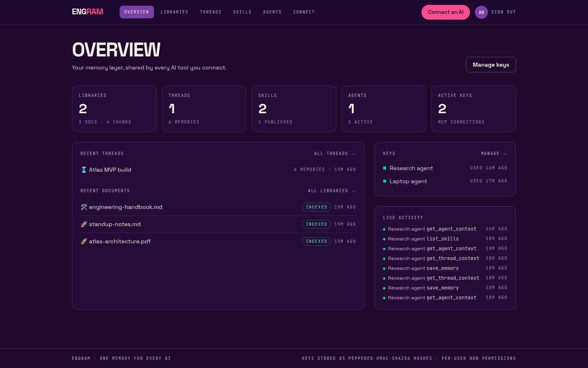
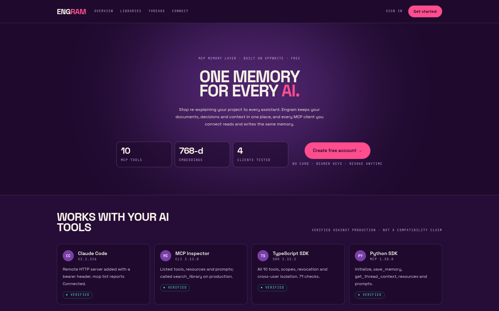
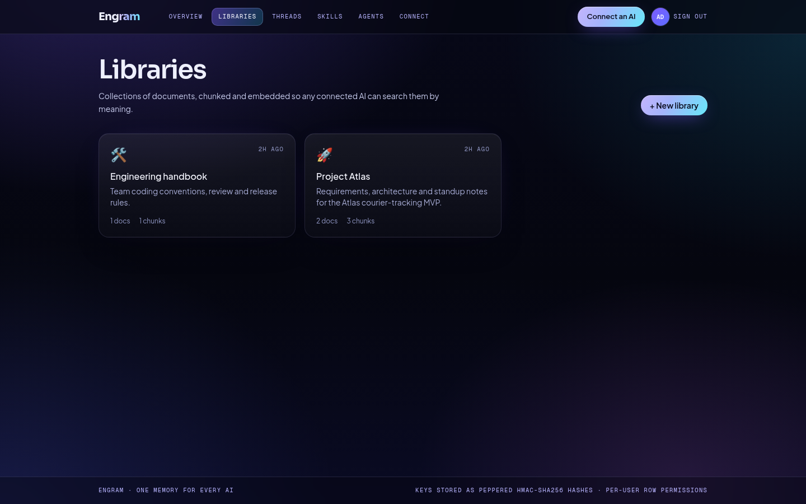
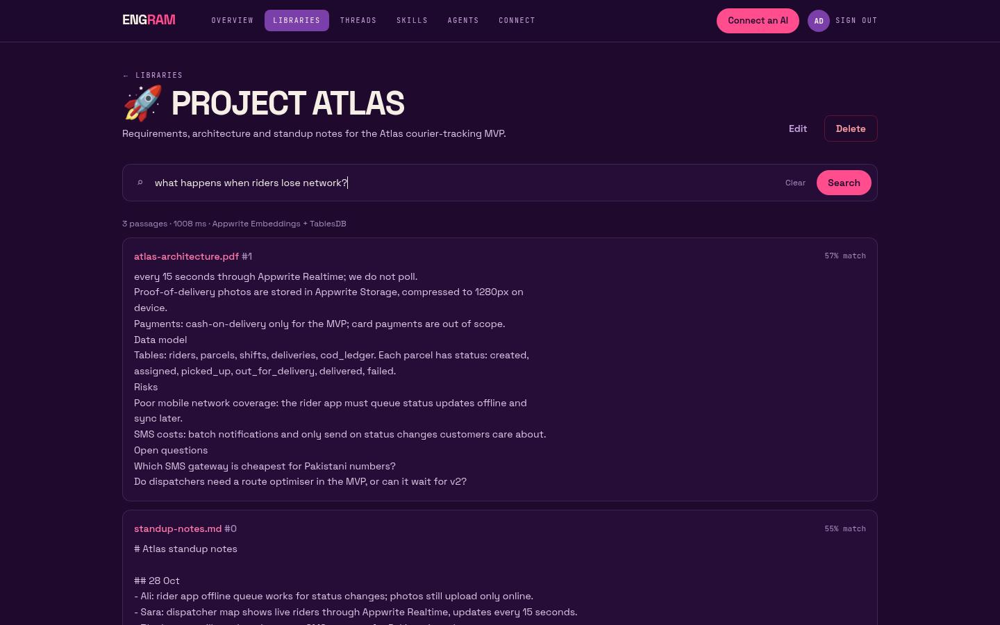
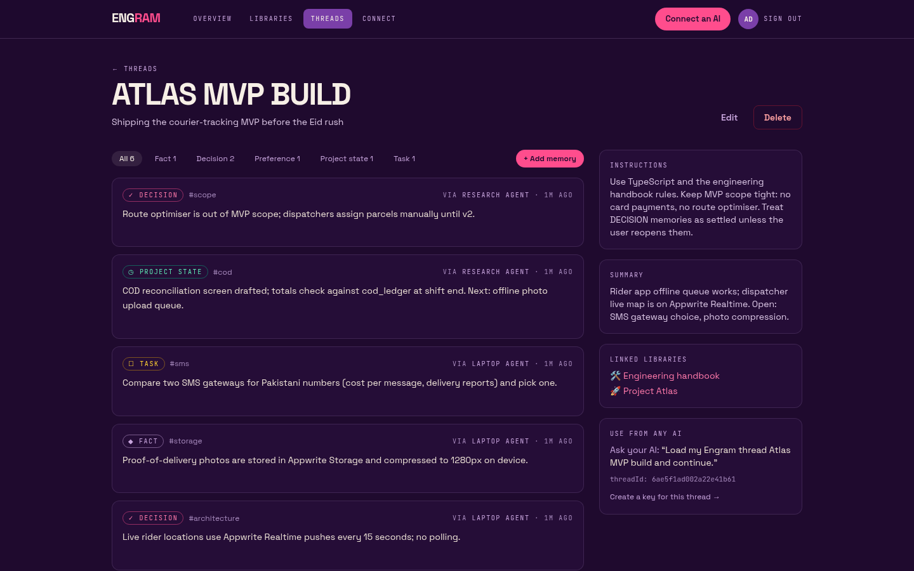
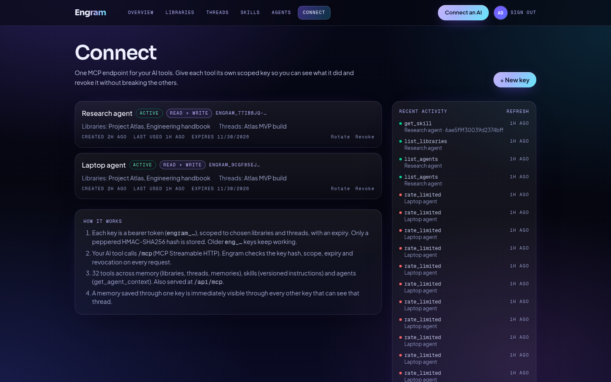
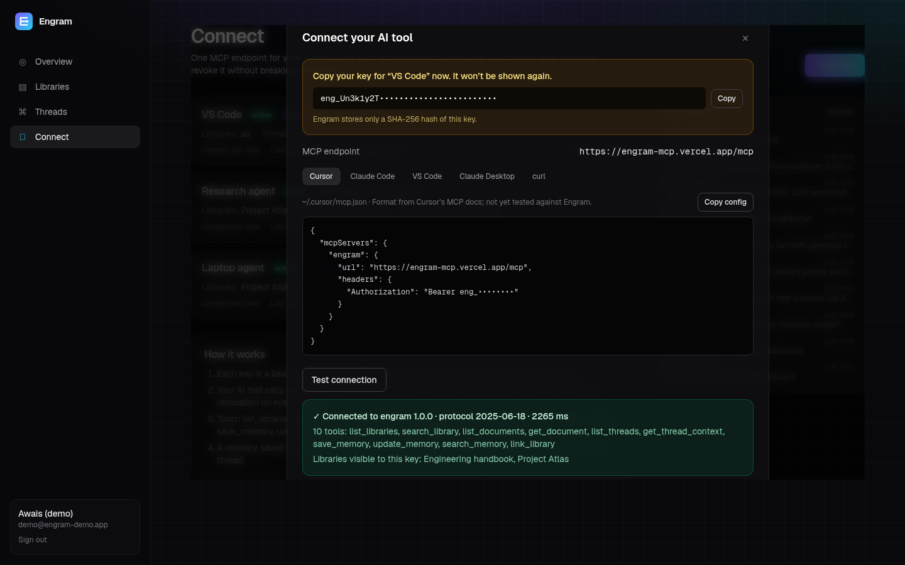
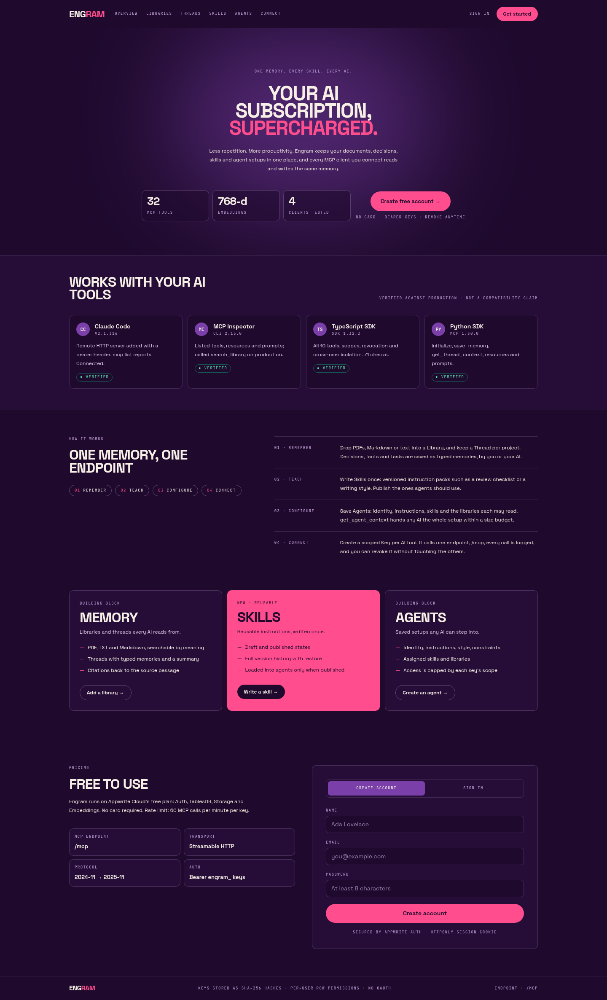

# Engram: one memory for every AI

Engram is a memory layer that you own, built on **Appwrite**. You keep your documents, project decisions and working context in one
place. Any MCP client you connect, such as Claude Code, MCP Inspector or your own agent, can search that context and add to it
through **one password-protected MCP endpoint**.

**Live (Appwrite Sites):** https://engram-ai.appwrite.network · **MCP endpoint:** `https://engram-ai.appwrite.network/mcp`

> Built for the Appwrite Databases Hackathon (Oct 2026). Built with Appwrite **TablesDB**, Auth, Storage and Embeddings.



## The problem

Each AI tool keeps its own memory. Decisions made in one chat are gone in the next tool, so you end up explaining your
project again every time. Engram keeps that context in one place, and every tool you connect reads from it.

**One memory. Two AI tools. Zero context loss.** If Claude Code saves a `DECISION` through one key, a second client using its
own key sees it right away through `get_thread_context`.

## Concepts

| Term | What it is |
| --- | --- |
| **Workspace** | Your account (Appwrite Auth). Every row in every table belongs to exactly one workspace. |
| **Library** | A collection of documents (PDF, Markdown, TXT, pasted text). Each document is split into chunks of about 900 characters and embedded. |
| **Thread** | Long-running context for a project or task: instructions, a summary, linked libraries and typed **memories**. |
| **Memory** | A typed entry: `FACT`, `DECISION`, `PREFERENCE`, `PROJECT_STATE`, `TASK`, `INSTRUCTION`, `SUMMARY` or `DOCUMENT_REFERENCE`. |
| **Key** | An MCP bearer token (`eng_…`) scoped to chosen libraries and threads. It is read-only or read and write, can expire and can be revoked. |

## Architecture

```
 MCP clients (Claude Code, Inspector, SDKs, …)       Browser dashboard
            │  POST /mcp  (Bearer eng_…)                  │ httpOnly Appwrite session cookie
            ▼                                             ▼
 ┌──────────────────────── Next.js 16 on Appwrite Sites ────────────────────────┐
 │  /mcp  stateless Streamable HTTP (MCP TS SDK 1.32)    /api/*  route handlers │
 │   └ key auth → scope check → tool → activity log       └ requireUser()       │
 │                 lib/: libraries · threads · keys · vector-store (interface)  │
 └───────────────────────────────┬──────────────────────────────────────────────┘
                                 │ node-appwrite (server API key, server-side only)
   Appwrite Cloud:  Auth · TablesDB (1 database, 7 tables) · Storage (1 bucket) · Embeddings (nomic-embed-text, 768-d)
```

**TablesDB tables** (all in database `notemind`; `scripts/setup-appwrite.mjs` creates them and is safe to run more than once):

| Table | Key columns | Indexes |
| --- | --- | --- |
| `libraries` | userId, name, description, icon | userId+$createdAt |
| `documents` | userId, libraryId, title, sourceType, mimeType, fileId, size, status (`uploaded/processing/indexed/failed`), error, chunkCount, content (mediumtext) | userId, libraryId |
| `chunks` | userId, libraryId, documentId, index, text, **embedding (longtext JSON, 768 floats)**, model | libraryId, documentId, userId |
| `threads` | userId, title, description, instructions, summary, libraryIds[] | userId+$updatedAt |
| `memories` | userId, threadId, type, content, tags[], embedding, source (key name), keyId | threadId+$createdAt, userId |
| `keys` | userId, name, **tokenHash (SHA-256, unique)**, prefix, allLibraries, libraryIds[], allThreads, threadIds[], canWrite, expiresAt, revokedAt, lastUsedAt | tokenHash (unique), userId |
| `activity` | userId, keyId, keyName, action, detail, status (`ok/denied/error`) | userId+$createdAt, keyId |

Original files are stored in the Storage bucket `documents` with owner-only file permissions. Deleting a document also deletes
its chunks (bulk `deleteRows`) and its file. Deleting a library deletes all of its documents.

### Retrieval

`src/lib/vector-store.ts` defines a small `VectorStore` interface (`upsert`, `search`, `deleteByDocument`). The MCP server and the
UI depend only on that interface. The current implementation, `TablesDBVectorStore`, stores each chunk's vector as a JSON
string in a longtext column. At query time it embeds the query with Appwrite Embeddings (using `search_query:`/`search_document:`
prefixes, which nomic needs) and ranks chunks from the allowed libraries using **85% cosine similarity + 15% keyword overlap**.
Each result comes back with its `documentTitle` and `chunkIndex` as a citation.

### VectorsDB vs TablesDB: why the adapter exists

Appwrite **VectorsDB** is the natural home for these vectors, and I tried to make it Engram's only database. Two attempts on
this Free-plan project (Appwrite Cloud, sfo, 31 Oct 2026):

1. With the TablesDB database still present, `vectorsDB.create()` returned
   `403 The maximum number of databases allowed for the selected plan has reached. Upgrade to increase the limit.`
2. After deleting the TablesDB database so the one-database slot was free, it returned
   `400 No shared vectorsdb pool is configured on this deployment. Pass a specification to create the database on a dedicated database.`
   The only specifications listed are paid dedicated instances (from $10/month), all disabled for this organisation.

So VectorsDB isn't available on the Free plan here, and I recreated the TablesDB schema with `scripts/setup-appwrite.mjs`.
A `VectorsDBVectorStore` can be added behind the same interface when a dedicated VectorsDB is available, with no changes
to the MCP server or UI. Brute-force ranking works well at demo
scale (thousands of chunks). It is the first part to replace for large libraries.

### Embedding storage test (768 dims in TablesDB)

Run with `node scripts/probe-embedding-storage.mjs`. Measured on 31 Oct 2026 against Appwrite Cloud (sfo):

| Test | Result |
| --- | --- |
| nomic-embed-text output | 768 dims |
| JSON, rounded to 1e-6 (what Engram stores) | **7,204 bytes** per vector; reads back byte-identical; max abs error vs. original 5e-7 |
| JSON, full precision | 9,457 bytes; reads back byte-identical |
| Bulk `createRows` with 50 chunk rows (text + vector) | OK; all 50 parse back as 768-d vectors |

Longtext columns are stored outside the fixed row-size budget, so a 7–10 KB string per row fits with plenty of room.
Splitting a vector across columns isn't needed. On one run, a list request made immediately after a bulk insert returned
fewer rows than were written. The same check passed on the rerun, so treat reads right after a bulk write as possibly lagging.
Embedding calls take about 0.5 s per chunk and fail on batches of 64 or more, so Engram embeds in batches of 16 with 3 in parallel.

## MCP server

`POST /mcp`: Streamable HTTP, **stateless** (no `Mcp-Session-Id`; each request builds a fresh server), JSON responses.
`GET`/`DELETE` return 405.

**Tools:** `list_libraries`, `search_library` (semantic + keyword, with citations), `list_documents`, `get_document` (paged),
`list_threads`, `get_thread_context` (instructions, summary, linked libraries, memories grouped by type), `save_memory`,
`update_memory`, `search_memory`, `link_library`. Every tool has a zod schema, a description and read-only/write annotations.
**Resources:** `engram://workspace`, `engram://libraries`, `engram://threads/{id}`, `engram://documents/{id}`.
**Prompts:** `load_project_context`, `research_library`, `resume_previous_work`.

### What was actually tested

| Client | Version | What was verified |
| --- | --- | --- |
| MCP TypeScript SDK client (`scripts/acceptance.mjs`) | `@modelcontextprotocol/sdk` 1.32.2 | All 10 tools, resources, prompts, scope, revocation, cross-user isolation. 71 checks, local and production |
| MCP Python SDK client (`scripts/mcp-python-client.py`) | `mcp` 1.30.0 | initialize, tools/list, save_memory, get_thread_context, read_resource, get_prompt against production |
| MCP Inspector CLI | `@modelcontextprotocol/inspector` 2.13.0 | tools/list, tools/call search_library, resources/list, prompts/list against production |
| Claude Code | 2.1.316 | `claude mcp add --transport http … --header "Authorization: Bearer …"`; `claude mcp list` reports **✔ Connected** (handshake only; no model session was run) |
| curl | n/a | Protocol negotiation, stateless `tools/list` with no initialize, 401/405/406 responses |

Protocol negotiation: the server answers `2024-11-05`, `2025-03-26`, `2025-06-18` and `2025-11-25` with the same version.
For an unknown future version it answers with its latest (`2025-11-25`). The config snippets for **Cursor** and **VS Code** in the
Connect page follow those vendors' MCP docs, but **I have not tested them against Engram**. The **Claude Desktop** snippet uses the
community `mcp-remote` bridge and is also untested. When a request fails auth, MCP Inspector tries OAuth discovery. Engram
doesn't implement OAuth, only bearer keys, so Inspector shows `auth_required` for a bad key.

### Connect a client

```bash
# Claude Code (tested)
claude mcp add --transport http engram https://engram-ai.appwrite.network/mcp --header "Authorization: Bearer eng_…"
```

```jsonc
// Cursor ~/.cursor/mcp.json (format from Cursor docs, untested)
{ "mcpServers": { "engram": { "url": "https://engram-ai.appwrite.network/mcp", "headers": { "Authorization": "Bearer eng_…" } } } }
```

## Security model

- **Keys:** 192-bit random tokens (`eng_` + base64url). The full key is shown once. Only the **SHA-256 hash** is stored and
  looked up through a unique index. The list API never returns the hash or the key.
- **Every MCP request** checks the key's hash, then that it hasn't been revoked or expired, then the rate limit (60/min per key,
  per server instance), and then the scope for each tool. Calls outside the key's scope fail with a tool error and are logged
  as `denied`. Read-only keys can't write.
- **Ownership on every operation.** All data access runs on the server with the Appwrite API key, so the app checks
  ownership itself. `getOwned()` loads a row and rejects it unless `row.userId === caller`. Indirect lookups re-check ownership
  at every step. For example, `get_document` loads the document, checks its owner, then checks the key's scope for the
  document's libraryId. `update_memory` goes from the memory to its thread, then checks ownership and scope. `link_library`
  checks both rows. Lists of IDs (thread libraryIds, key scopes, search libraryIds) are filtered to the caller's own rows
  before they are stored or used.
  Rows and files also carry owner-only Appwrite permissions (`read/update/delete: user:<id>`) as a second layer.
- **Rotate** revokes the old key and issues a new key with the same scope. Activity (tool, key, outcome) is logged per key and
  shown in the dashboard. `lastUsedAt` is updated on each use.
- **Dashboard sessions:** Appwrite email/password sessions are kept in an httpOnly, `SameSite=Strict`, Secure cookie.
- `scripts/acceptance.mjs` covers cross-user attacks: user B reuses user A's real library, document, thread, memory and key
  IDs against every dashboard route and MCP tool and resource. Every one is rejected, and A's data is checked afterwards to
  confirm nothing changed.

## Run it

```bash
npm install
cp .env.example .env.local            # fill in the project id + server API key
node --env-file=.env.local scripts/setup-appwrite.mjs   # creates the tables, indexes and bucket (safe to re-run)
npm run dev
BASE=http://localhost:3000 node --env-file=.env.local scripts/acceptance.mjs   # 71 end-to-end checks
BASE=http://localhost:3000 node scripts/seed-demo.mjs                          # demo workspace → DEMO_ACCOUNT.txt
```

Deploy: **Appwrite Sites**, connected to this repo's `main` branch, so every push builds and activates a deployment.
Site settings: framework `nextjs`, adapter `ssr`, build runtime `node-24`, install `npm install`, build `npm run build`,
output `./.next`, request timeout 60 s (the Sites maximum). Site variables: `NEXT_PUBLIC_APPWRITE_ENDPOINT`,
`NEXT_PUBLIC_APPWRITE_PROJECT_ID`, `APPWRITE_DATABASE_ID`, `APPWRITE_BUCKET_ID` and `APPWRITE_API_KEY` (marked secret).
Project: `6ae5ea70000968dca787` in Frankfurt (`https://fra.cloud.appwrite.io/v1`).

## Screenshots

| | |
| --- | --- |
|  |  |
|  |  |
|  |  |
|  |  |

Mobile (390 px): [landing](docs/screenshots/10-mobile-landing.png) · [overview](docs/screenshots/09-mobile-overview.png) · [thread](docs/screenshots/08-mobile-thread.png)

**Visual language:** plum `#1F0A2E` ground, cream `#F6EFE6` text, pink `#FF4D8D` actions (dark plum text on pink, 5.9:1),
violet `#7A3FA8` surfaces, lilac `#C9A6DE` mono labels (8.8:1 on plum), panel `#250D37` bands. Space Grotesk poster headlines and
JetBrains Mono labels via `next/font`. Single column under 900 px.

## Limits and honest notes

- VectorsDB needs a paid dedicated instance on this project, so Engram uses TablesDB (see above).
- Documents are indexed inside the upload request, which Appwrite Sites caps at 60 s. There is no background queue. Each document is
  limited to 10 MB and 400 chunks.
- The rate limit is held in memory, per serverless instance. It isn't global.
- Bearer keys only. There is no OAuth flow, so hosted connectors that require OAuth (e.g. claude.ai custom connectors) can't use Engram directly.

## License

MIT
