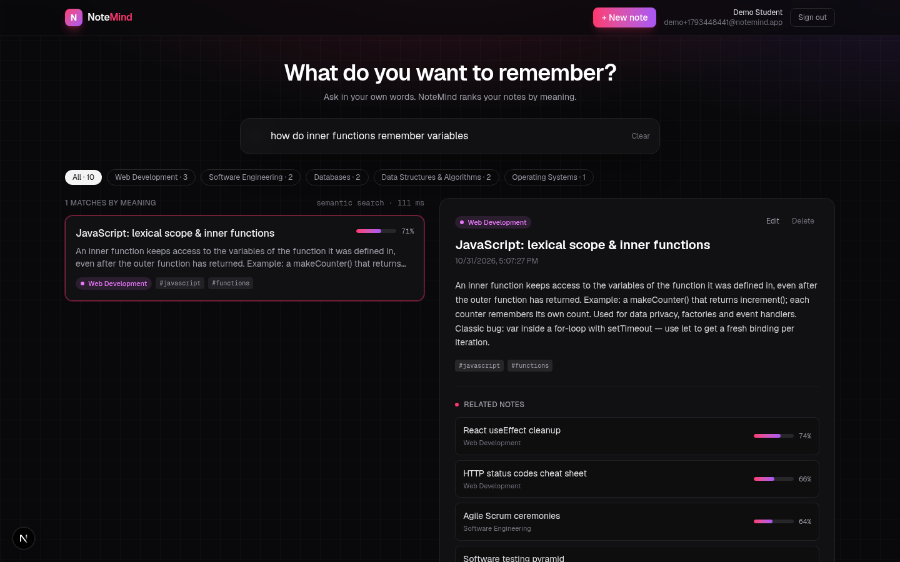
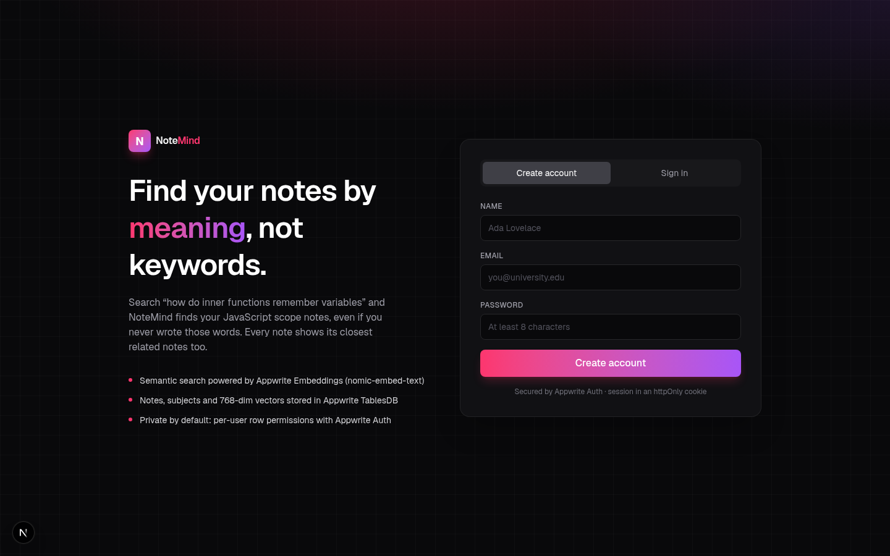
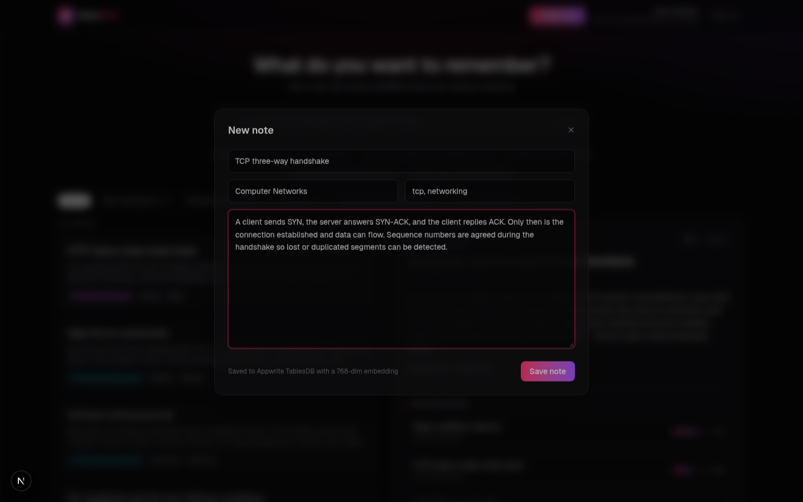
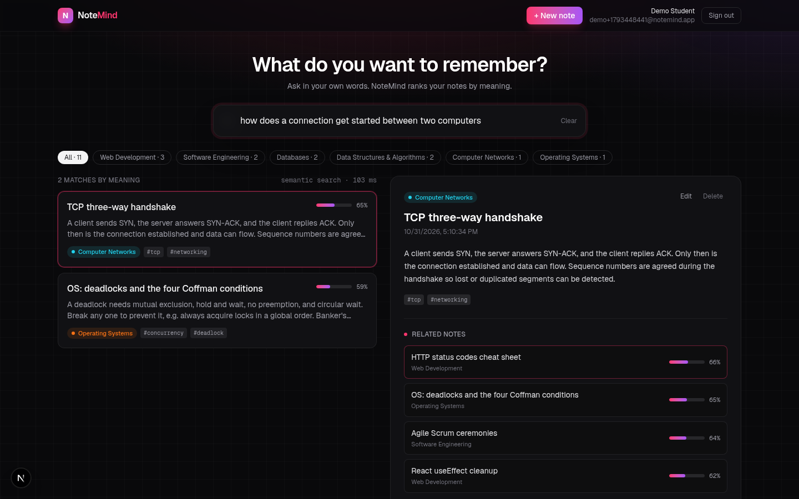

# NoteMind 🧠

**Search your study notes by meaning, not keywords.**

NoteMind is a study-notes app for students. Write or paste lecture notes, then ask in your own words:
*"why is my program stuck waiting forever"* finds your **deadlocks** note, and *"how do inner functions remember variables"*
finds your **JavaScript scope** note, even though neither note uses those words. Every note also shows its **related notes**,
so revising one topic surfaces the connected ones.

**Live demo:** https://notemind-nine.vercel.app

Built solo for the **Appwrite Databases Hackathon** (Oct 19–31, 2026).



## Features

- **Semantic search** across all your notes, ranked by cosine similarity, with a match score for each result
- **Related notes** panel on every note (nearest neighbours of the note's own vector)
- Add, **edit** (re-embeds automatically) and delete notes, with subjects and tags
- Subject filter chips that combine with semantic search
- One-click **sample notes** (10 computer-science notes) to try it in seconds
- Email/password **Appwrite Auth**, httpOnly session cookie, per-user row permissions
- Search-first dark UI, `Ctrl/⌘ K` to focus search, loading, empty and error states

## How it uses Appwrite Databases

| Appwrite product | What NoteMind uses it for |
| --- | --- |
| **TablesDB** | Database `notemind`, table `notes` with typed columns: `userId` (varchar 36), `title` (varchar 200), `subject` (varchar 64), `tags` (varchar[] ), `content` (mediumtext), `embedding` (longtext, the 768-dim vector as JSON), `model` (varchar). Row security on, each row readable/writable only by its owner (`Role.user`). Indexes `by_user` (`userId`, `$createdAt` desc) and `by_user_subject` (`userId`, `subject`). Cursor pagination with `Query.select` to pull only the columns a request needs. |
| **Embeddings** | `createTextEmbeddings` with the built-in **nomic-embed-text** model (768 dimensions) turns each note, and each search query, into a vector. No third-party AI service needed. Uses nomic's `search_document:` / `search_query:` task prefixes for better retrieval. |
| **Auth** | Email/password accounts and sessions (SSR pattern: session secret in an httpOnly `a_session_<project>` cookie). |

### Why not VectorsDB?
VectorsDB would be the natural home for the vectors (HNSW index + `Query.vectorCosine`). On the Appwrite Cloud **Free** plan in
the `sfo` region, creating a VectorsDB database returns *"No shared vectorsdb pool is configured… pass a specification"* and every
dedicated specification is disabled for the plan. So NoteMind stores the vectors in **TablesDB** and ranks them on the server.
The data model (one vector + metadata per note) maps 1:1 onto a VectorsDB collection, so moving the vectors there is a small,
contained change in `src/lib/notes.ts` once a pool is available.

## Architecture

```
Browser (Next.js client components)
   │  fetch /api/*   (httpOnly session cookie)
   ▼
Next.js route handlers (server only, node-appwrite)
   ├─ Auth:     Account.createEmailPasswordSession → cookie; Account.get per request
   ├─ Write:    Embeddings.createTextEmbeddings → TablesDB.createRow / updateRow
   └─ Search:   embed query → TablesDB.listRows (user's rows, select embedding)
                → cosine similarity → adaptive cutoff → top matches
```

The Appwrite API key only ever lives in server environment variables. The browser never talks to Appwrite directly.

## Run it locally

```bash
git clone <this repo> && cd notemind
npm install
cp .env.example .env.local      # fill in APPWRITE_API_KEY
node scripts/setup-appwrite.mjs # creates the database, table, columns and indexes (idempotent)
npm run dev                     # http://localhost:3000
```

The API key needs these scopes: `users.write`, `sessions.write`, `databases.write`, `tables.write`, `columns.write`,
`indexes.write`, `rows.read`, `rows.write`, `embeddings.write`.

## Tech stack
Next.js 16 (App Router) · TypeScript · Tailwind CSS 4 · node-appwrite 31 · Appwrite Cloud · Vercel

## Project structure
```
src/lib/appwrite.ts      admin + session clients
src/lib/notes.ts         embeddings, CRUD, semantic search, related notes
src/app/api/**           auth, notes, search, seed routes
src/components/          AuthScreen, NotesApp (search UI, note panel, editor modal)
scripts/setup-appwrite.mjs  provisions the Appwrite resources
```

## Screenshots
| Sign in | Add a note | Search a new topic |
| --- | --- | --- |
|  |  |  |

## License
MIT
